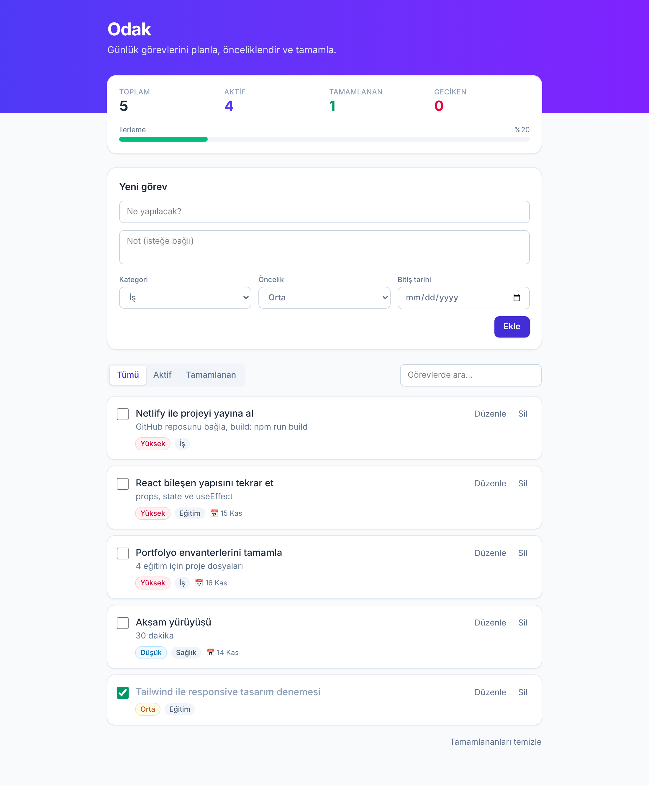
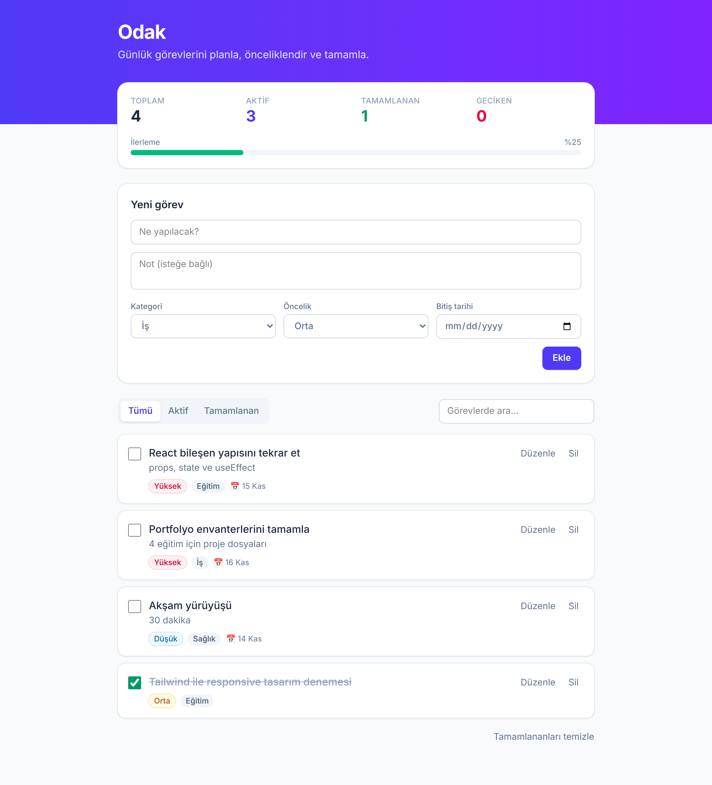
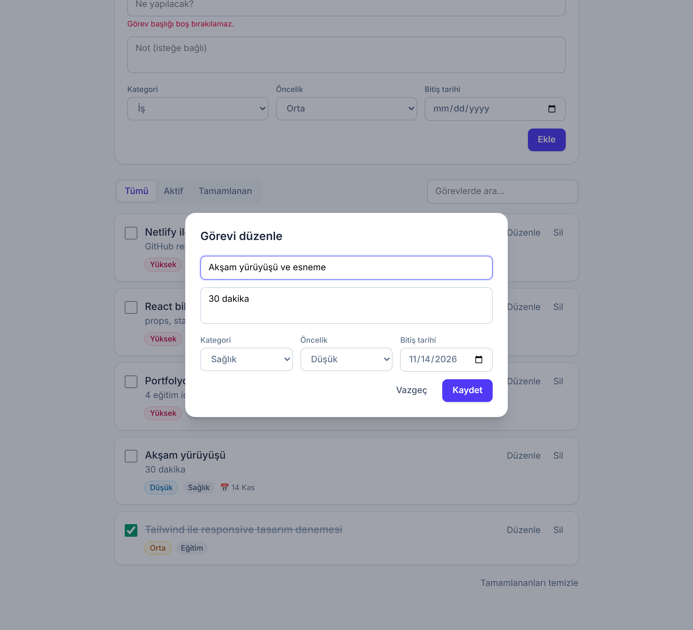
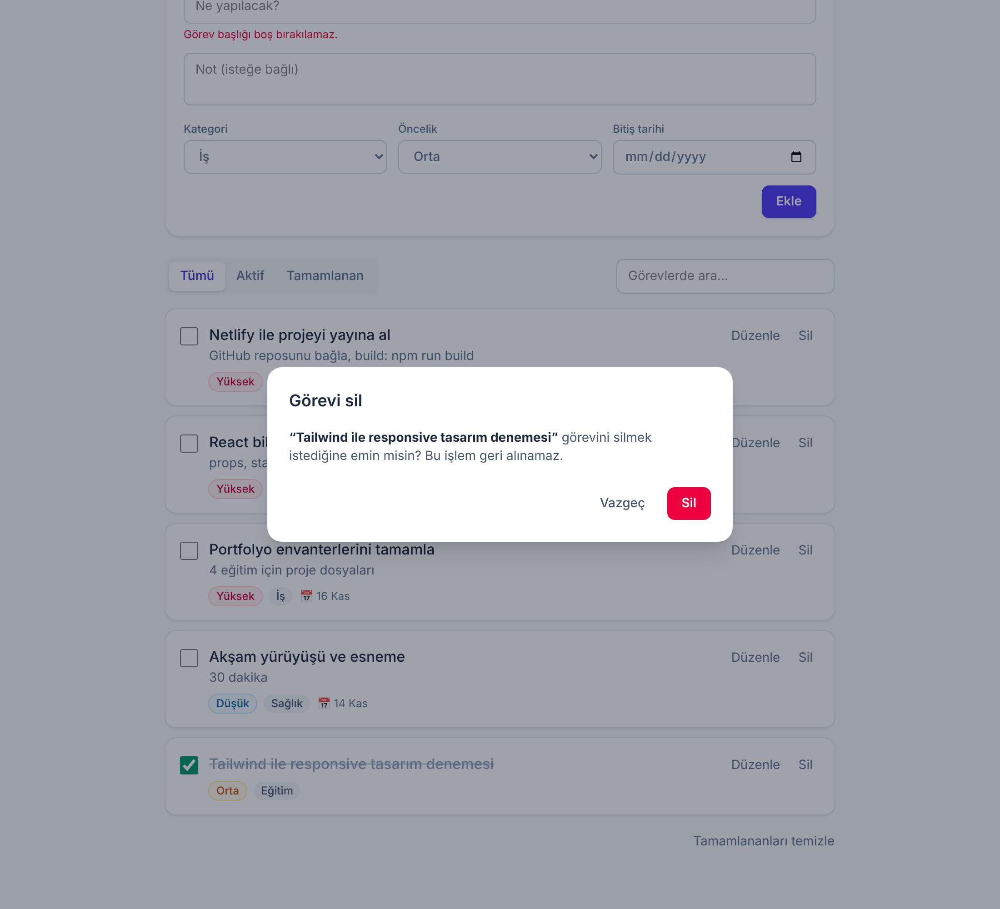
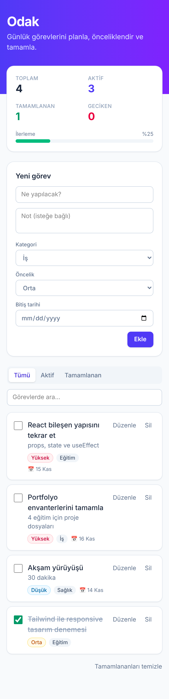

# Odak · Görev Planlayıcı

React + TypeScript + Tailwind CSS ile geliştirilmiş, verileri tarayıcının **LocalStorage**
alanında saklayan bir görev planlama uygulaması. TODO App mantığını; kategori, öncelik,
bitiş tarihi, arama, filtreleme ve ilerleme takibi ile genişletir.

> Web Geliştirme; JavaScript Eğitimi · Proje Çalışması · 2026

🔗 **Canlı demo:** Netlify ile yayına alınmaya hazır (`netlify.toml` yapılandırılmış)  
📦 **Kaynak kod:** https://github.com/BurakOsmanClk/odak-gorev-planlayici



## Özellikler

| İşlem | Nasıl yapılır |
|---|---|
| **Ekle** | "Yeni görev" formundan başlık, not, kategori, öncelik ve tarih girilerek |
| **Listele** | Görevler aktif → tamamlanan ve önceliğe göre sıralı listelenir; Tümü / Aktif / Tamamlanan filtresi ve arama kutusu |
| **Güncelle** | "Düzenle" ile açılan pencerede tüm alanlar değiştirilir; onay kutusuyla tamamlandı işaretlenir |
| **Sil** | "Sil" düğmesi ve onay penceresi; "Tamamlananları temizle" ile toplu silme |

Ek olarak: özet kartları (toplam / aktif / tamamlanan / geciken), ilerleme çubuğu, geciken
görevlerin vurgulanması, boş başlık doğrulaması, Esc ile pencere kapatma ve mobil uyumlu tasarım.

## Kullanılan Teknolojiler

- **React 18** – bileşen tabanlı arayüz, `useState`, `useEffect`, `useMemo`, özel hook'lar
- **TypeScript** – `interfaces/` klasöründe veri tipleri
- **Tailwind CSS 4** – yardımcı sınıflarla responsive tasarım
- **Vite** – geliştirme sunucusu ve derleme
- **LocalStorage** – kalıcı veri saklama
- **Netlify** – yayına alma

## Klasör Yapısı

```
src/
├── components/        # Tekrar kullanılabilir arayüz parçaları
│   ├── TaskForm.tsx   # Ekleme ve düzenleme formu
│   ├── TaskItem.tsx   # Tek görev satırı
│   ├── FilterBar.tsx  # Filtre ve arama
│   ├── StatsBar.tsx   # Özet kartları ve ilerleme
│   └── Modal.tsx      # Açılır pencere
├── pages/
│   └── HomePage.tsx   # Ana sayfa: bileşenleri bir araya getirir
├── interfaces/
│   └── Task.ts        # Task, Priority, Category tipleri
├── hooks/
│   ├── useLocalStorage.ts  # State'i LocalStorage ile eşitler
│   └── useTasks.ts         # Ekle / Listele / Güncelle / Sil mantığı
├── App.tsx
├── main.tsx
└── index.css          # Tailwind girişi
```

## Kurulum ve Çalıştırma

```bash
git clone https://github.com/BurakOsmanClk/odak-gorev-planlayici.git
cd odak-gorev-planlayici
npm install
npm run dev        # http://localhost:5173
```

Üretim derlemesi: `npm run build` (çıktı `dist/` klasörüne)

## Netlify ile Yayına Alma

1. Projeyi GitHub'a public repo olarak yükleyin.
2. Netlify → **Add new site → Import an existing project** → GitHub reposunu seçin.
3. Ayarlar `netlify.toml` dosyasından otomatik okunur: build komutu `npm run build`, yayın klasörü `dist`.
4. **Deploy** → verilen `*.netlify.app` adresini bu README'ye ve teslim formuna ekleyin.

Alternatif: `npm run build` sonrası `dist` klasörünü https://app.netlify.com/drop sayfasına sürükleyip bırakmak.

## Ekran Görüntüleri

| Listeleme | Güncelleme | Silme onayı | Mobil |
|---|---|---|---|
|  |  |  |  |
